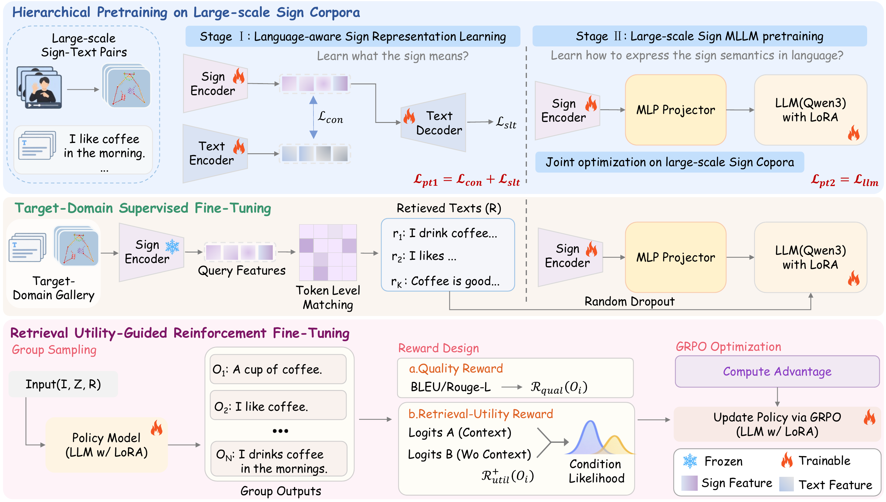

# SignRAG

<p align="center">
  <a href="https://huggingface.co/rao0/SignRAG-Qwen3-8B-CSL-Daily-PreinNews">
    
  </a>
  <a href="https://arxiv.org/abs/2610.11371">
    
  </a>
  
  
  
</p>

<p align="center">
  <b>SignRAG</b> — Unified Retrieval-Augmented, Gloss-Free Sign Language Translation<br>
</p>

---

## 🏗️ Framework



## 📁 Repository layout

```
SignRAG/
├── inference.py            # main inference entry point
├── data.py                 # dataset + collation
├── utils.py                # metrics helpers
├── llava/                  # LLaVA-style multimodal model code
├── metrics/                # BLEU / ROUGE implementations
├── scripts/run_inference.sh
├── requirements.txt
└── README.md
```

## 🛠️ Installation

```bash
conda create -n signrag python=3.10
conda activate signrag
pip install -r requirements.txt
# GPU build of torch (example, CUDA 12.1):
pip install torch==2.1.2 torchvision==0.16.2 --index-url https://download.pytorch.org/whl/cu121
```

Python 3.10, PyTorch 2.1 and Transformers 4.51 are recommended.

## 📦 Model & data assets

**Model weights:** [Hugging Face — SignRAG-Qwen3-8B-CSL-Daily-PreinNews](https://huggingface.co/rao0/SignRAG-Qwen3-8B-CSL-Daily-PreinNews)

| Asset | Description |
|-------|-------------|
| `SignRAG-Qwen3-8B-CSL-Daily-PreinNews/` | Merged Qwen3-8B backbone + tokenizer |
| `non_lora_trainables.bin` | Visual encoder, temporal conv, sign embedding & projector |
| `mytran_CSL_News_512/` | mBART-based visual-encoder init model |
| `CSL_Daily/pose_format/*.pkl` | Raw skeleton keypoints |
| `rag_dep.test` | Evaluation labels (gzipped pickle) |

**CSL-Daily pose data** (modified vs. older version) — download directly from
[Hugging Face — Uni-Sign](https://huggingface.co/ZechengLi19/Uni-Sign).

## 🚀 Quick start (4 GPUs)

```bash
export CUDA_VISIBLE_DEVICES=0,1,2,3

torchrun --nproc_per_node=4 inference.py \
  --model_dir /path/to/SignRAG-Qwen3-8B-CSL-Daily-PreinNews \
  --non_lora_trainables /path/to/non_lora_trainables.bin \
  --v_init_model /path/to/mytran_CSL_News_512 \
  --data_path /path/to/rag_dep.test \
  --keypoint_path /path/to/CSL_Daily/pose_format \
  --data_version CSL_Daily \
  --language zh \
  --output_dir ./outputs/csl_daily \
  --infer_batch_size 2 \
  --beam_size 4 \
  --max_new_tokens 80
```

Or use the provided script:

```bash
bash scripts/run_inference.sh
```

> The script defaults to 4 GPUs. Set `NPROC_PER_NODE` / `CUDA_VISIBLE_DEVICES` to change.

## 📊 Output

Written to `--output_dir`:

- `tmp_pres.txt` / `tmp_refs.txt` — predictions and references
- `result_bleu.txt` — BLEU / ROUGE metrics

## 📝 Notes

- Inference uses the flex visual encoder; raw keypoints are loaded from `--keypoint_path`.
- For CSL-Daily, `--data_version CSL_Daily` is required to read `pose_format/*.pkl`.
- Batch size must stay modest (2–4) because sign sequences have variable length.

## 🙏 Acknowledgements

Thanks to **CoSign** for the powerful sign encoder implementation:
[CoSign paper (ICCV 2023)](https://openaccess.thecvf.com/content/ICCV2023/papers/Jiao_CoSign_Exploring_Co-occurrence_Signals_in_Skeleton-based_Continuous_Sign_Language_Recognition_ICCV_2023_paper.pdf)

## 📚 References

```bibtex
@article{rao2026signrag,
  title={SignRAG: Unified Retrieval-Augmented Gloss-Free Sign Language Translation},
  author={Rao, Zhi and Zhou, Yucheng and Sun, Qianran and Huang, Yiqing and Yuan, Longcan and Hou, Jiayi and Yao, Chengwen and Cheng, Lin and Sun, Donghui and Chen, Xiaoxin and others},
  journal={arXiv preprint arXiv:2610.11371},
  year={2026}
}

@inproceedings{rao2026rvlf,
  title={Rvlf: A reinforcing vision-language framework for gloss-free sign language translation},
  author={Rao, Zhi and Zhou, Yucheng and Zhou, Benjia and Huang, Yiqing and Escalera, Sergio and Wan, Jun},
  booktitle={Proceedings of the IEEE/CVF Conference on Computer Vision and Pattern Recognition},
  pages={9237--9247},
  year={2026}
}
```

## 📄 License

Apache 2.0.
